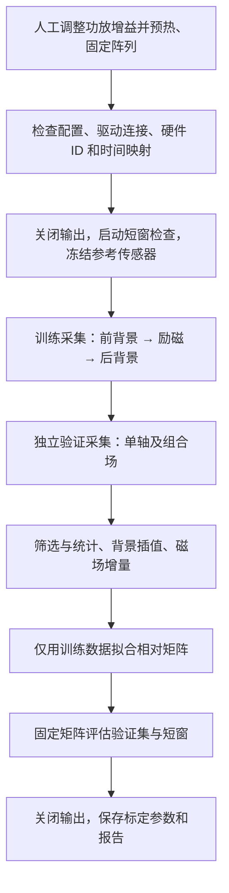

# AK09973D 阵列一致性标定：流程、文件与算法

更新日期：2026-10-16。本文依据当前 `sensor_array_bringup` 实现编写，供实验操作、数据追溯和结果分析使用。文中的电平与时序对应当前配置，实际运行参数以每次实验保存的 `config.yaml` 为准。本文不是某次实验的验收报告。

## 1. 标定目标和数据流

对象为同一阵列中的 12 颗 AK09973D 三轴磁传感器。将阵列固定在三维亥姆霍兹线圈中心，逐方向施加近似均匀的直流增量场，通过多档正负励磁，求出每颗传感器相对于同一参考传感器的 3×3 校正矩阵。

标定改善相对增益、实际安装角与线性轴间耦合造成的不一致，不依赖精确的电压—电流—磁场换算模型。信号源电压只用于安排励磁条件，不作为磁场真值进入拟合。



当前程序仅输出参数和报告，不覆盖 `ak/affine.json`，也不把结果自动接入在线校正节点。不辨识真实零偏，不建立绝对磁场真值，不校正交流相位或温度效应。参考传感器的公共畸变仍会保留。

## 2. 实验配置与操作流程

### 2.1 配置入口及当前五档电平

相关文件：

- 实验配置：[consistency_calibration.yaml](../config/consistency_calibration.yaml)。
- FY8300 专用启动配置：[fy8300_calibration.yaml](../config/fy8300_calibration.yaml)。
- 标定启动入口：[consistency_calibration.launch](../launch/consistency_calibration.launch)。
- 传感器安装矩阵与位置：由实验配置的 `array_geometry` 指定，当前为 `sensor_array_config/config/array_01/ak/array.json`。

| 励磁轴 | 信号源通道 | 五档直流电平绝对值（V） | 本次软件电压上限（V） | 默认独立验证电平绝对值（V） |
| --- | --- | --- | --- | --- |
| X | CH1 | 1、2、3、4、5 | 5 | 2.5 |
| Y | CH2 | 0.4、0.8、1.2、1.6、2 | 2 | 1.0 |
| Z | CH3 | 1、2、3、4、5 | 5 | 2.5 |

五档来自人工观察：X/Z 输入 5 V、Y 输入 2 V 时，读数约 1500 μT。在背景已扣除且响应近似线性的前提下，五档增量约为 300、600、900、1200、1500 μT；这些仅为选档估计，不是精密实测值。

程序使用直流波形 `waveform=6`、波形 `amplitude=0` 和有符号 `offset`。负向试验取相同电平的负值，不使用负的波形幅值。`max_abs_offset_v` 是本实验的软件限制，不代表信号源、功放或线圈的硬件额定值。

### 2.2 启动前准备

1. 人工完成放大器增益调整和设备预热；正式实验不再改变增益。
2. 将阵列固定在线圈中心，保持电缆、机械臂和附近物体不动；核对实际接线与 X/Y/Z 通道映射。
3. 检查 12 颗传感器的 ID、总线及 TCA mask 与实物一致，并核对安装矩阵 Q。`axes_confirmed: true` 表示人工确认，不是软件自动识别的结果。
4. 将实际 STATS 的设备 ID 填入 `firmware_device_id`。诊断话题的 `observed_device_id` 可作为来源；标定配置与 `single_array.yaml` 是两个独立文件，不自动同步。
5. 确认正负直流均可正常励磁，关闭输出后背景可重复恢复，默认 1 秒建立／衰减等待适合现场响应。检查全部 12 颗的背景及励磁读数，不能只看单颗或平均值。
6. 当前标定代码仅对原始 int16 边界作裁剪检查，不会根据上位机显示中的约 3600 μT 告警阈值自动中止。应另行确认各档及组合场的实际工作范围。

### 2.3 启动阵列与检查计划

在工作区执行，若阵列上位机已经运行则不重复启动第一条 launch：

```bash
cd /home/zhang/embedded_array_ws_dual
source devel/setup.bash

# 终端 A：启动阵列串口、协议等上位机节点
roslaunch sensor_array_bringup array.launch \
  config:=/home/zhang/embedded_array_ws_dual/src/sensor_array_bringup/config/single_array.yaml
```

在另一个已 source 相同工作区的终端检查标定配置：

```bash
rosrun sensor_array_bringup consistency_calibration \
  --config src/sensor_array_bringup/config/consistency_calibration.yaml --check

rosrun sensor_array_bringup consistency_calibration \
  --config src/sensor_array_bringup/config/consistency_calibration.yaml --dry-run
```

`--check` 检查 YAML、通道、电平、安装矩阵和几何数据；`--dry-run` 额外打印状态计划。两者不连接设备、不设置输出、不创建实验目录，因此通过检查不代表硬件通信已经通过。

### 2.4 正式启动与最低档试采

正式标定入口：

```bash
roslaunch sensor_array_bringup consistency_calibration.launch
```

`start_generator` 当前默认 `true`，自动启动 FY8300 驱动并加载专用的全关闭初始配置。不要同时再启动另一个占用同一串口的 FY8300 驱动。驱动已在运行时改用：

```bash
roslaunch sensor_array_bringup consistency_calibration.launch start_generator:=false
```

节点应连接同一 ROS master。标定订阅当前设备的 `/array_01/maggrad/sample` 原始话题及 `/fy8300/ch1/status`～`ch3/status`，不使用已有仿射校正后的 `sample_corr`。FY8300 的控制话题会先于初始化完成建立连接，因此程序先在 `connection_timeout_s` 内等待三个通道各有两次有效状态回读，再开始控制；这属于驱动就绪检查，不是设备预热等待。每次设置都等待两个新鲜、有效且与目标一致的状态回读；发布了命令不等于设置成功。

首次联调可在阵列和 FY8300 驱动均已运行时执行：

```bash
rosrun sensor_array_bringup consistency_calibration \
  --config src/sensor_array_bringup/config/consistency_calibration.yaml --smoke-test
```

该命令只做 X 轴最低档正负两组，输出试采记录，不拟合标定矩阵。Y/Z 的接线、极性和完整工作范围仍需核对。它与正式标定不可并行运行。

### 2.5 自动采集过程

启动时先核对 STATS 硬件 ID、建立设备时间到主机单调时间的估计映射，确认关闭全部输出，然后做一次启动检查。默认 `startup_s=3` 秒，不循环等待预热。启动检查也须满足有效样本数量和时间覆盖要求。

`reference_id: null` 时，程序在所有 12 颗均通过启动检查后，依次按有效样本数较多、子窗口均值离散较小、标准差较小排序；最终以 ID 打破平局。参考选择后冻结，验证数据不参与选择。指定参考 ID 也不能绕过启动质量检查。短窗选择不能证明长期重复性。

训练计划为：三轴 × 五档 × 正负 × 三轮 = **90 个 trial**。每轮随机化状态顺序，种子保存在配置中。每个 trial 有独立的三段采集：

| 阶段 | 操作 | 默认时长 |
| --- | --- | --- |
| OFF_PRE_SETTLE | 关闭全部输出，等待背景恢复 | 1 s |
| OFF_PRE_CAPTURE | 前背景采集 | 3 s |
| ON_SETTLE | 设置目标直流电平并开启对应通道，等待建立 | 1 s |
| ON_CAPTURE | 励磁平台采集 | 3 s |
| OFF_POST_SETTLE | 关闭全部输出，等待衰减 | 1 s |
| OFF_POST_CAPTURE | 后背景采集 | 3 s |
| PROCESS_TRIAL | 统计、背景插值和质量检查 | 随处理耗时 |

采集时每段前后默认各排除 0.25 秒边界，因此 3 秒采集对应约 2.5 秒的统计区间。每颗每窗口目标为至少 500 个有效新样本；仅样本数不足时，以 0.5 秒步长延长至最多 15 秒。时间缺口、漂移／噪声超限等质量失败会拒绝本组并重采，默认最多额外重采两次。启动窗口失败直接结束，不按 trial 重采。

控制超时、设备身份／时间异常和断流会中止，不作为普通质量失败反复重采。中止及 Ctrl+C/SIGTERM 都会尝试关闭全部输出；关闭失败写入事件并报警。无法执行清理的强制杀进程或断电情形需现场处理。

独立验证另采 **12 个 trial**：X、Y、Z、XY、XZ、YZ 六种方向各正负一次，组合场中参与轴取相同正负极性。各轴默认验证电平取其第 2、3 档中点，也可设置 `validation_v`。所有验证 trial 均不参与拟合。

90 组训练的纯等待／采集基础时间约 18 分钟，12 组验证再增加约 2.4 分钟；设备命令、两次状态回读、样本不足延长与重采都会增加时间，不能把 18 分钟当总运行时长。

## 3. 中间文件和结果保存位置

当前配置为：

```yaml
output_root: ../../../data/consistency
```

路径相对于实验 YAML 所在目录解析，当前实际根目录是：

```text
/home/zhang/embedded_array_ws_dual/data/consistency/
```

每次正式采集或试采都会创建独立目录并在终端打印 `Run directory:`：

```text
run_YYYYMMDDTHHMMSS.ffffffZ/
  config.yaml
  events.csv
  raw_stream.csv
  windows.json
  samples.csv
  startup.json
  trial_summary.csv
  short_validation.csv
  validation.csv
  calibration.json
  report.md
```

目录名采用 **UTC 时间**，其中 `Z` 表示 UTC；北京时间需要加 8 小时。CSV 按记录批次刷新，失败前已落盘的数据会保留。文件按流程实际进度创建，早期失败或最低档试采不会产生全部结果文件。

| 文件 | 内容及用途 |
| --- | --- |
| `config.yaml` | 解析后的实验配置快照：档位、随机种子、时序、ID、地址、Q、位置及相关门限。追溯实验时优先看这个快照，而不是事后改过的源配置。 |
| `events.csv` | `t_monotonic,event,detail`；记录命令、回读确认、时钟锁定、状态切换、窗口延长、拒绝、重采和退出原因。排障首先查这里的最早失败事件。 |
| `raw_stream.csv` | 身份验证通过后，适配器处理的已解码 AK 样本流，含过渡段、窗口外、时钟未锁定或其他被标记无效的记录。它不是串口字节流，也不保存解码器已经丢弃的坏帧。 |
| `windows.json` | 每个统计窗口的单调时间 `start/end`、`trial_id`、`split`、`phase`、`attempt`；用于核对样本时间归属。 |
| `samples.csv` | 从原始样本流按映射后的采样时间抽取的窗口记录，附加实验、trial、阶段和尝试编号；窗口内无效样本也保留，是离线重新拟合的原始计数来源。 |
| `startup.json` | 启动窗口的逐传感器统计和冻结的 `reference_id`。 |
| `trial_summary.csv` | 每行一个 trial/attempt/传感器，包含条件、前背景／励磁／后背景统计、插值系数、背景、增量、接受状态和拒绝原因。 |
| `short_validation.csv` | 验证平台按当前 0.1 秒应用窗口划分后的前后指标、窗口接受状态和失败原因。 |
| `validation.csv` | 12 个独立验证状态的校正前后误差、最大通道差、伪梯度、改善率及逐传感器参考残差。 |
| `calibration.json` | 完整实验拟合成功后的参数：各颗 Q/T、参考 ID、单位、适用模式、训练 trial、奇异值、条件数、配置哈希及验证结果。 |
| `report.md` | 面向人工阅读的结果摘要、逐颗训练残差与逐状态验证对比；失败时保存失败说明。 |

### 3.1 数据字段约定

- `split` 区分 `startup`、`train`、`validation` 和最低档试采的 `smoke`。
- 正式 trial 从 1 编号；启动检查为 trial 0。`attempt=0` 为首次尝试，1/2 为两次重采。分析时必须联合 trial、attempt 和 sensor_id 对齐。
- `raw` 为 HX/HY/HZ 有符号原始计数；`x` 为经过 1.1 μT/count 与 Q 转换后的三轴值；`mask` 是 TCA 通道位掩码。
- `round_seq` 为固件轮次编号。固件没有独立的逐传感器序号，`sample_seq` 留空；不因相邻读数相同就判为重复。
- `t_device=(device_tick_unwrapped_us+read_done_offset_us)×10^-6`，单位秒；它是设备读取完成时间，不是芯片内部转换时刻。
- `t_host` 为换算到单调时钟的主机帧接收时刻，`t_arrival` 为标定回调执行时刻，`t` 为设备样本映射后的单调时间。时钟尚未锁定时 `t` 为空，样本不用于统计。
- `drdy/err/dor`、`valid/reason` 保留筛选依据。`comm_ok=true` 仅表示该样本来自已解码记录，不表示此前没有发生通信失败；设备错误另记 `DEVICE_ERRORS`，断流有独立诊断。
- CSV 的向量、矩阵和嵌套对象是 JSON 文本，读取时需再解码；空字段不能直接当作数值 0。缺测温度在标定 JSON 中为 null。

`raw_stream.csv` 不按回调当前状态填充 phase，阶段归属应结合 `windows.json` 和样本 `t` 判断。正常延迟且在读取窗口数据前到达的记录按采样时间归属；更晚到达的记录仍可在原始流中追溯，不能假定都会自动补进已经结束的 `samples.csv`。

ROS 进程日志通常另存于 `~/.ros/log/<会话 ID>/`，不是上述实验目录。若终端仅提示 `process has died`，需要联合实验 `events.csv` 和 ROS 日志查看具体原因；最后一条关闭错误可能掩盖最初的连接或采集错误。

## 4. 算法说明

下文三维向量均为列向量，磁场单位为名义 μT，位置单位为 m。

### 4.1 原始量转换与有效性筛选

对传感器 i 的原始计数向量 r：

$$
\mathbf x_i(t)=\mathbf Q_i\,[1.1\,\mathbf r_i(t)].
$$

Q 来源于安装配置，把芯片坐标转为名义阵列坐标。当前路径不先应用已有 affine 参数，防止重复校正。

排除未就绪 DRDY=0、ERR 非零、无效标记、原始计数裁剪、非法时间及不属于窗口的样本。DOR=1 表示有更新曾被覆盖，当前有效读数仍保留，并报告 DOR 比例。代码不使用自适应平滑来改变响应幅值。

### 4.2 时间映射与窗口统计

从至少 5 个、跨度至少 `clock_lock_s`（默认 1 秒）的到达样本中，取主机接收时刻与该轮最晚读取设备时刻之差的最小值作为偏移 c，锁定后使用：

$$
t_{mapped}=t_{device}+c.
$$

映射固定单位斜率；后续监视到达残差，超出配置界限或出现重复／乱序轮次、设备时间回退则中止。该方法不是硬件同步，不能独立测出固定串口延迟，长时间晶振漂移也可能触发中止。窗口两端保护量用于降低边界归属的不确定性。

每颗每个窗口计算有效样本数 n、均值、平均样本时刻、样本协方差、标准差、有效采样率和 DOR 比例：

$$
\boldsymbol\mu_i=\frac{1}{n}\sum_j\mathbf x_i(t_j),\qquad
\bar t_i=\frac{1}{n}\sum_jt_j.
$$

将窗口按默认 0.5 秒分段，计算子窗口均值、离散程度、首末均值差，并拟合各轴随时间的斜率。要求完整子窗口有覆盖，样本间隙及两端覆盖满足限制，不能只凭总样本数通过。

噪声、漂移和背景变化门限分别由 `max_std_ut`、`max_slope_ut_s`、`max_background_change_ut` 控制。当前为 null，因此只报告对应统计、不作数值门限拒绝；这不等于软件已经证明平台稳定。

### 4.3 前后背景插值与增量计算

每个 trial、每颗传感器分别获得前背景、励磁、后背景的均值及平均时刻，记作下标 −、on、+。按励磁样本的平均时刻插值背景：

$$
\alpha_i=\frac{t_i^{on}-t_i^-}{t_i^+-t_i^-},\qquad
\widehat{\mathbf x}^{bg}_i=(1-\alpha_i)\boldsymbol\mu_i^-+\alpha_i\boldsymbol\mu_i^+,
$$

$$
\Delta\mathbf x_i=\boldsymbol\mu_i^{on}-\widehat{\mathbf x}^{bg}_i.
$$

要求前背景时刻 < 励磁时刻 < 后背景时刻；每颗使用自己的背景，不拿参考传感器背景替代。该方法可消除均值层面的线性缓慢漂移，不能保证消除突发干扰或非线性变化。现场背景不是永久器件零偏。

一组 trial 只有全部 12 颗通过才接受。正负励磁各自保留为一个样本，不先合并成正负差分。

### 4.4 3×3 相对校正矩阵拟合

冻结参考传感器 r，将每个传感器的 K 个已接受训练增量按同一 trial 顺序排列：

$$
X_i=[\Delta\mathbf x_{i,1},\ldots,\Delta\mathbf x_{i,K}]\in\mathbb R^{3\times K}.
$$

求解无截距的普通最小二乘：

$$
T_i=\arg\min_T\|TX_i-X_r\|_F^2=X_rX_i^\dagger,\qquad T_r=I.
$$

代码实际将样本按行保存为 `(K,3)`，调用 `numpy.linalg.lstsq`，再转置解矩阵。使用 SVD 路径，不显式求正规方程逆矩阵；不拟合截距，不估计真实零偏。

拟合前核对完整计划、trial/attempt/ID 对齐及数据有限性，要求各传感器训练矩阵秩为 3。保存奇异值及条件数：

$$
\kappa_i=\sigma_{max}/\sigma_{min}.
$$

当前 `rcond=1e-10`、`max_condition=1000`；秩不足或条件数超限拒绝求解。条件数通过表示数值上可解，不保证现场激励均匀或达到定位精度。

训练残差为各 trial 的映射误差向量平方模取均值后开方：

$$
RMSE_i^{train}=\sqrt{\frac1K\sum_k\|T_i\Delta\mathbf x_{i,k}-\Delta\mathbf x_{r,k}\|^2}.
$$

### 4.5 独立验证的一致性指标

验证时固定 T，不重新拟合。每个验证状态得到校正后向量 z：

$$
\mathbf z_i=T_i\Delta\mathbf x_i,\qquad
\bar{\mathbf z}=\frac1{12}\sum_i\mathbf z_i.
$$

主要指标为：

$$
e=\sqrt{\frac1{12}\sum_i\|\mathbf z_i-\bar{\mathbf z}\|^2},\qquad
d=\max_{i,j}\|\mathbf z_i-\mathbf z_j\|.
$$

分别对应 `vector_rmse_ut` 和 `max_pairwise_ut`，单位 μT；此外保存各颗相对于参考传感器的残差模。校正前对原始增量用完全相同方式计算，改善比例为 `1 - after/before`，分母接近零时返回 null。

`data_valid=true` 表示数据对齐及数值求解有效。`performance_pass` 为 null 表示未设性能门限，false 表示未通过已设门限；两种情况都不能表述为已达到定位精度。当前性能门限均为 null。

### 4.6 伪梯度的空间线性最小二乘

梯度仅用于均匀增量场下的一致性评估，不参与 T 的拟合，也不自动抹除真实空间差异。

设位置为 p，磁场向量 b 为校正前增量或校正后 z，建立一阶空间模型：

$$
\mathbf b_i\approx\mathbf b_0+G(\mathbf p_i-\bar{\mathbf p}),\qquad
G_{ab}=\frac{\partial B_a}{\partial p_b}.
$$

构造位置和磁场去均值后的 `(12,3)` 矩阵 P、Y：

$$
P_{i,:}=(\mathbf p_i-\bar{\mathbf p})^T,\qquad
Y_{i,:}=(\mathbf b_i-\bar{\mathbf b})^T,
$$

$$
\widehat G^T=P^\dagger Y.
$$

所有传感器等权参与，不施加 G 对称或无迹约束。因此它与实际应用中可能使用的受约束梯度求解器不完全相同。位置矩阵秩不足 3 时返回 null；当前只保存 Frobenius 范数，不保存完整九分量矩阵：

$$
\|\widehat G\|_F=\sqrt{\sum_{a,b}\widehat G_{ab}^2}.
$$

字段为 `gradient_frobenius_ut_m`，单位 μT/m。均匀增量场中的该值包含通道不一致、噪声、位置误差及真实线圈不均匀性的共同影响，不能全部归因于传感器误差，也不能视作绝对梯度真值。

### 4.7 应用短窗验证

将独立验证的励磁平台按 `short_window_s`（当前 0.1 秒）切分。每颗在短窗内重新计算均值和平均时刻，使用原 trial 的前后背景重新插值，应用同一固定 T，计算同样的一致性和伪梯度指标。

短窗要求每颗至少有有效样本；不会对每个 0.1 秒窗口强制要求长窗的 500 个样本。长平均改善不代表短窗同样改善；相邻短窗共用背景，也不是完全独立的重复实验。

## 5. 查看结果与离线重新拟合

完整实验结束后，先阅读 `report.md`，再核查：

1. `events.csv` 是否有异常、窗口延长或重采；各颗有效采样率、DOR 和漂移是否合理。
2. 参考 ID、模式、Q、位置与配置哈希是否对应本次装置。
3. 各颗条件数和训练残差是否异常，独立验证的各方向及正负状态是否都改善，避免只看总体平均。
4. 最大通道差、伪梯度和 0.1 秒短窗指标是否满足实际任务需求；有无尚未设置的性能门限。

需要复算已完成实验时运行：

```bash
rosrun sensor_array_bringup consistency_calibration \
  --refit /home/zhang/embedded_array_ws_dual/data/consistency/run_YYYYMMDDTHHMMSS.ffffffZ
```

该模式不连接硬件。从源目录读取配置、冻结参考、窗口边界、trial 元数据与 `samples.csv` 原始计数，重新执行坐标转换、统计、插值、拟合和验证。先核对源 `calibration.json` 的配置哈希及参考 ID；不要修改源实验快照，否则会拒绝复算。

程序使用 `/tmp` 下临时 SQLite 索引按窗口读取，正常退出后清理临时索引。新结果写入源配置 `output_root` 下另一个 `run_<timestamp>` 目录，通过新 `events.csv` 的 `REFIT_SOURCE` 记录来源，不覆盖原实验。复算目录不会复制原始 ROS 全流；完整追溯需保留源实验目录。

失败或最低档试采目录没有完整 `calibration.json`，不支持用 `--refit` 自动补齐为成功实验。目前也不支持中断后从断点接着采集。

## 6. 参数使用与代码对应

后续应用固定矩阵时，数学关系为：

$$
\Delta\widehat{\mathbf B}_i=T_i\{Q_i[1.1\mathbf r_i]-\widehat{\mathbf x}^{bg}_i\}.
$$

需要当前姿态和环境下的背景，不能把本次背景当作永久零偏。前后背景插值依赖未来数据；实时应用若仅有前背景，应单独设计因果背景估计并验证漂移。本工具不会自动建立这条在线链路。

| 源码模块 | 对应功能 |
| --- | --- |
| [consistency.py](../src/sensor_array_bringup/consistency.py) | 配置／几何校验、励磁计划、窗口统计、背景插值、参考选择、SVD 拟合、一致性和梯度指标 |
| [consistency_collect.py](../src/sensor_array_bringup/consistency_collect.py) | 采集状态机、重采、记录落盘、长短窗验证组织、报告和离线复算 |
| [consistency_ros.py](../src/sensor_array_bringup/consistency_ros.py) | 设备身份核对、时间映射、AK 原始订阅、FY8300 控制与回读、命令行入口和中止处理 |

更详细的设计依据见 [基线规格](AK09973D_consistency_calibration_baseline.md)，精简命令和字段说明见 [使用说明](consistency_calibration_usage.md)。
